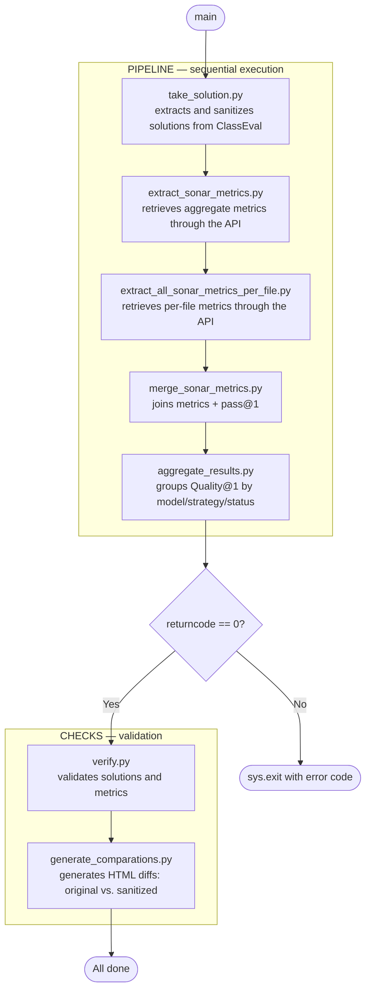

# Quality@1: A Metric Based on Software Quality Attributes for Evaluating Source Code Generated by Large Language Models

> For the English setup guide, see [docs/README.en.md](docs/README.en.md).

This repository contains the static-analysis pipeline used in the undergraduate thesis *"Quality@1: A Metric Based on Software Quality Attributes for Evaluating Source Code Generated by Large Language Models."* It investigates whether functionally correct code (measured by Pass@k on the ClassEval benchmark) also has good structural quality, as measured by SonarQube.

## Context

The [ClassEval](https://github.com/FudanSELab/ClassEval) benchmark evaluates LLMs on generating complete Python classes across 100 tasks. This work analyzes **3 models + GroundTruth = 4 groups**, all using the Holistic (H) strategy:

| Model | Code | Profile |
|--------|-------|--------|
| GPT-4-Turbo | H | High performance |
| GPT-3.5-Turbo | H | High performance |
| WizardCoder-15B-V1.0 | H | High performance |
| GroundTruth | GT | Human reference (ClassEval) |

The **Holistic (H)** strategy generates the complete class from a prompt in a single pass. GroundTruth is identified by the **GT** code and has `pass@1 = 1.0` by definition.

### Collected Metrics

- **Cognitive Complexity** — the mental effort required to understand code
- **Cyclomatic Complexity** — the number of independent paths through the control flow
- **Code Smells** — maintainability issues that may indicate poor practices
- **SQALE Index** — accumulated technical debt in minutes (SonarQube)
- **Quality@1 (FQS)** — the metric proposed in this work; combines Pass@1 with technical debt normalized by LOC

## Prerequisites

- [Docker](https://www.docker.com/) installed and running
- `output/ClassEval_output/` populated with the raw ClassEval files (model-output JSONs and `detailed_result.json`)

## Running SonarQube

The repository uses the SonarQube image containing the analyses behind the
paper's results. Select the image that matches your machine once by copying
the corresponding settings file to `.env`:

Windows (AMD64):

```powershell
Copy-Item .env.windows .env
```

Apple Silicon Mac (ARM64):

```bash
cp .env.macos .env
```

Then start SonarQube:

```bash
docker compose up -d sonarqube
```

The `.env` selection is local and Git-ignored; Compose uses it for subsequent
commands, including pipeline and SonarQube analysis commands. Intel Macs should
use `.env.windows` and the AMD64 image. Both settings files pin the image
digest as well as the architecture. Both builds use SonarQube
26.4.0.121862.

SonarQube will be available at [http://localhost:9000](http://localhost:9000).

Use the administrator credentials configured for the preloaded image; this is
not a blank SonarQube instance, so the default first-login credentials may not
apply. Allow a few minutes for the interface to become fully available.

## Quality@1 Pipeline

### Running the scripts in a Python container

The `python` service installs the project dependencies, mounts the repository
at `/app`, and stays running with Compose. To open a shell in the container:

```bash
docker compose up -d python
docker compose exec python sh
```

To run a one-off script (the temporary container exits when it finishes):

```bash
docker compose run --rm python scripts/test_fqs.py
```

To run the full pipeline, start SonarQube first, then run the pipeline in the
Python container:

```bash
docker compose up -d sonarqube
docker compose run --rm python scripts/pipeline.py
```

The Python container can also run other project scripts, for example:

```bash
docker compose run --rm python scripts/compute_fqs.py --pass_val 1.0 --sqale 120 --ncloc 80
```

File changes and generated results remain in the local directory because the
repository is mounted into the container. SonarQube remains available at
[http://localhost:9000](http://localhost:9000).

### Formula

```
Quality@1(t) = Pass@1(t) × (1 − min(1, β × SQALE_Index(t) / NCLOC(t)))
```

Where `Pass@1(t) ∈ {0, 1}`, `β = 0.1`, `SQALE_Index` is technical debt in minutes (SonarQube), and `NCLOC` is the number of non-commented lines of code.

### Running locally

With Python 3 and pandas installed:

```bash
python3 scripts/pipeline.py
```

The following steps run automatically:

| Step | Script | Description |
|-------|--------|-----------|
| 1 | `take_solution.py` | Extracts and sanitizes solutions from the ClassEval JSONs; generates `pass_results.csv` |
| 2 | `extract_sonar_metrics.py` | Retrieves project-level aggregate metrics through the SonarQube API |
| 3 | `extract_all_sonar_metrics_per_file.py` | Retrieves per-file metrics for all projects through the SonarQube API |
| 4 | `merge_sonar_metrics.py` | Combines the raw CSVs with `pass_results.csv` and calculates FQS for each task |
| 5 | `aggregate_results.py` | Aggregates FQS by `(model, strategy, status)` |

After the pipeline, these diagnostic scripts run automatically:

| Script | Description |
|--------|-----------|
| `verify.py` | Checks the count (100 classes per model), Markdown contamination, AST errors, and mismatches between `combined_sonar_metrics.csv` and `pass_results.csv` |
| `generate_comparations.py` | Generates per-model HTML diffs (original vs. sanitized) in `output/validation/` |



### Outputs

All files are generated under `output/`:

| File | Description |
|---------|-----------|
| `output/solutions/{model}/*.py` | Sanitized solutions for each model |
| `output/solutions/originals/{model}/*.py` | Raw model responses |
| `output/results/raw/sonar_metrics*.csv` | Raw SonarQube CSVs — per-file metrics |
| `output/results/pass_results.csv` | Input mapping `(model, class)` → `pass@1` + status |
| `output/results/combined_sonar_metrics.csv` | Main output: SonarQube metrics + FQS per task |
| `output/results/aggregated_results.csv` | Mean FQS by `(model, strategy, status)` |
| `output/validation/comparation-{llm}.html` | Per-model HTML diffs: original vs. sanitized |

---

## Reanalyzing projects

To submit the projects to SonarQube again from scratch:

```bash
# Make sure SonarQube is running.
docker compose up -d

# Create projects and local tokens (replace with the current admin password).
SONAR_AUTH='admin:<password>' ./scripts/setup_sonar_projects.sh

./scripts/run_sonar.sh
```

The setup requires `curl` and `python3`, saves tokens to `scripts/.sonar-tokens`
(ignored by Git), and can be rerun to generate new tokens. The analysis script
builds the Compose Python image and runs `pysonar` in the container to submit
each project to SonarQube.

## Repository Structure

```
.
├── compose.yaml                              # Starts SonarQube and the Python service
├── scripts/
│   ├── pipeline.py                           # Runs the full Quality@1 pipeline
│   │
│   ├── # — Extraction (SonarQube API) —
│   ├── extract_all_sonar_metrics_per_file.py # Retrieves per-file metrics for all projects
│   ├── extract_sonar_metrics.py              # Retrieves project-level aggregate metrics
│   │
│   ├── # — Main pipeline —
│   ├── take_solution.py                      # Extracts and sanitizes solutions from ClassEval JSONs
│   ├── merge_sonar_metrics.py                # Combines raw CSVs and calculates FQS per task
│   ├── aggregate_results.py                  # Aggregates FQS by (model, strategy, status)
│   ├── compute_fqs.py                        # Pure function for the Quality@1 formula
│   ├── sort_csv.py                           # Sorts a CSV by (model, strategy, file)
│   │
│   ├── # — Diagnostics —
│   ├── verify.py                             # Validates solutions and checks metrics against pass_results.csv
│   ├── generate_comparations.py             # Generates per-model HTML diffs: original vs. sanitized
│   │
│   └── # — SonarQube —
│       ├── run_sonar.sh                      # Submits all projects to SonarQube
│       ├── setup_sonar_projects.sh           # Creates SonarQube projects and tokens
│       └── delete_sonar_projects.sh          # Deletes SonarQube projects
│
└── output/
    ├── ClassEval_output/                     # Input: raw ClassEval files (provided separately)
    │   ├── model_output_v1.0.0/             # Model output JSONs
    │   └── result/
    │       └── detailed_result.json
    ├── solutions/                            # Generated by take_solution.py
    │   ├── {model}/
    │   │   └── *.py                         # Sanitized solutions
    │   └── originals/
    │       └── {model}/
    │           └── *.py                     # Raw model responses
    ├── results/                             # Generated by the pipeline
    │   ├── raw/
    │   │   └── sonar_metrics*.csv           # Raw per-file metrics
    │   ├── pass_results.csv                 # (model, class) → pass@1 + status
    │   ├── combined_sonar_metrics.csv       # Main output: metrics + FQS per task
    │   └── aggregated_results.csv           # Mean FQS by (model, strategy, status)
    └── validation/                          # Generated by generate_comparations.py
        └── comparation-{llm}.html
```

## Statistical report

- `docs/statistical_report.md` — detailed statistical analysis report

## Docker setup

Compose uses separate named volumes for the historical SonarQube image, so it
does not reuse or downgrade data from the previous official image. The volumes
persist across restarts. To reset the historical instance, stop the service
and remove its volumes with `docker compose down -v`. This permanently deletes
the local SonarQube projects, settings, and analysis history.

### Reproducible metrics

SonarQube findings can change when the server version, Python quality profile,
active rules, or project settings change, even when the source code and pipeline
scripts stay the same. For comparable results, record and use the same SonarQube
version and quality profile, and keep the scanner configuration (including
`sonar-project.properties`) consistent.
