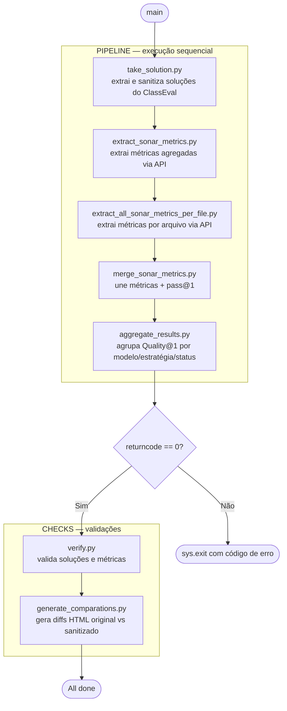
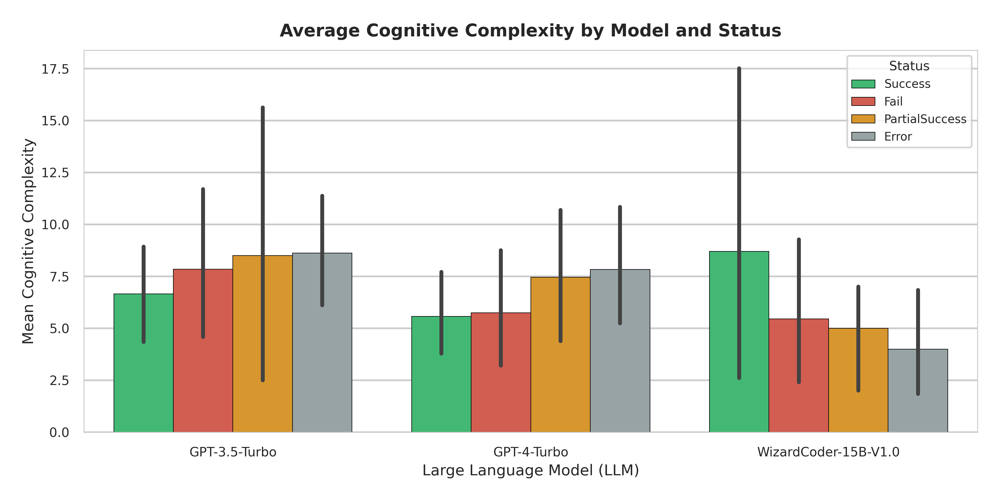
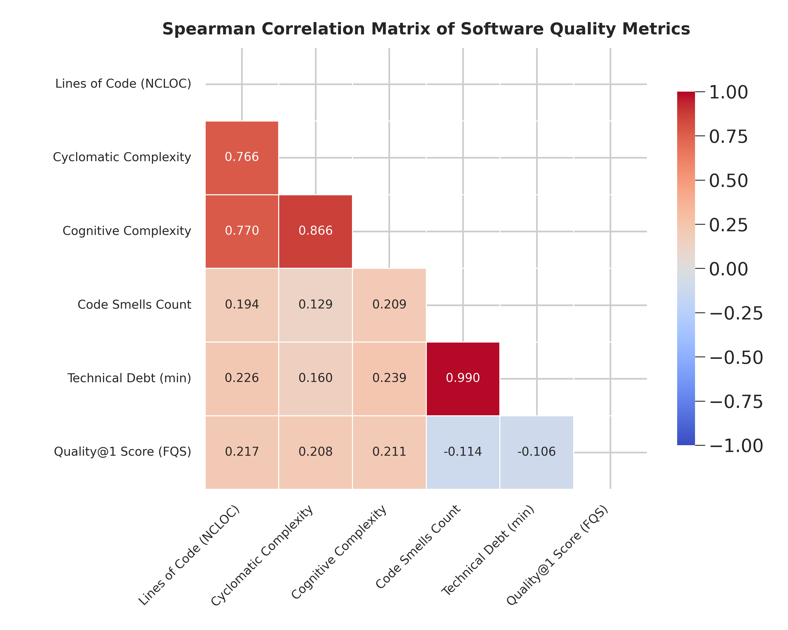
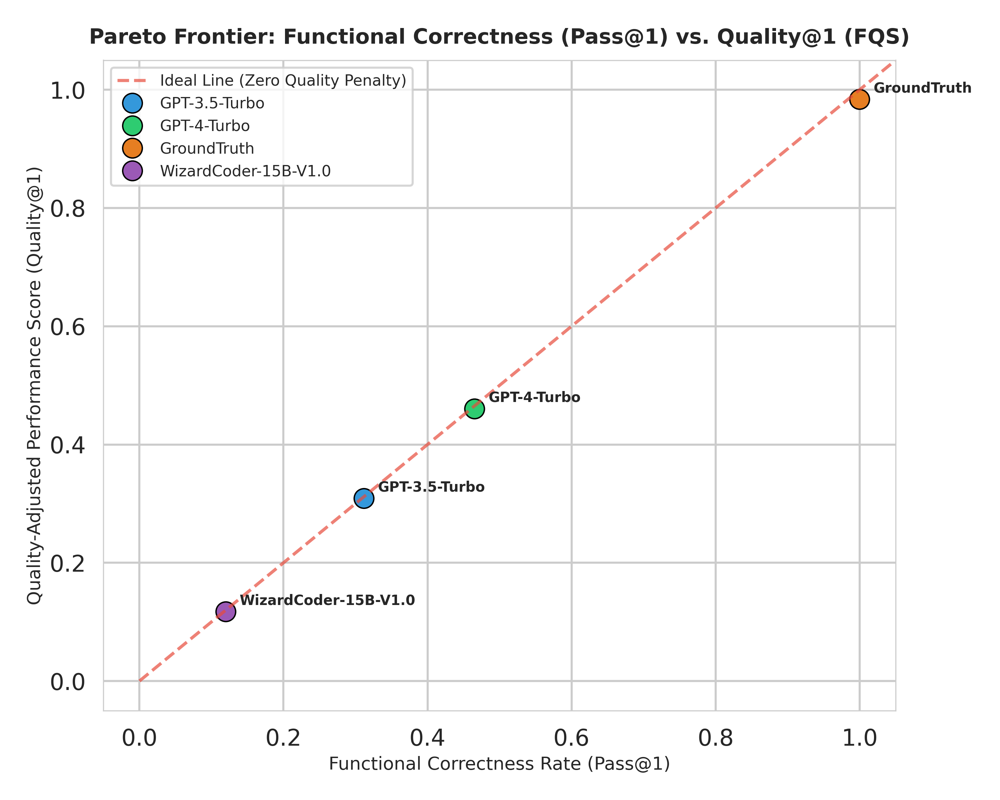

# Quality@1: Uma Métrica Baseada em Atributos de Qualidade de Software para Avaliação de Código Fonte Gerado por Grandes Modelos de Linguagem

> 🇺🇸 [Read in English](docs/README.en.md)

Este repositório contém o pipeline de análise estática utilizado no TCC *"Quality@1: Uma Métrica Baseada em Atributos de Qualidade de Software para Avaliação de Código Fonte Gerado por Grandes Modelos de Linguagem"*. O objetivo é investigar se código funcionalmente correto (medido pelo Pass@k do benchmark ClassEval) também apresenta boa qualidade estrutural, medida via SonarQube.

## Contexto

O benchmark [ClassEval](https://github.com/FudanSELab/ClassEval) avalia LLMs na geração de classes Python completas com 100 tarefas. Este trabalho analisa **3 modelos + GroundTruth = 4 grupos**, todos usando a estratégia Holística (H):

| Modelo | Sigla | Perfil |
|--------|-------|--------|
| GPT-4-Turbo | H | Alto desempenho |
| GPT-3.5-Turbo | H | Alto desempenho |
| WizardCoder-15B-V1.0 | H | Alto desempenho |
| GroundTruth | GT | Referência humana (ClassEval) |

A estratégia **Holística (H)** gera a classe completa de uma só vez a partir do prompt. O GroundTruth é identificado pela sigla **GT** e tem `pass@1 = 1.0` por definição.

### Métricas Coletadas

- **Complexidade Cognitiva** — esforço mental para compreender o código
- **Complexidade Ciclomática** — quantidade de caminhos independentes no fluxo de execução
- **Code Smells** — indícios de más práticas que impactam manutenibilidade
- **SQALE Index** — dívida técnica acumulada em minutos (SonarQube)
- **Quality@1 (FQS)** — métrica proposta neste trabalho, combina Pass@1 e dívida técnica normalizada por LOC

## Pré-requisitos

- [Docker](https://www.docker.com/) instalado e em execução
- `output/ClassEval_output/` populado com os arquivos brutos do ClassEval (JSONs de saída dos modelos e `detailed_result.json`)

## Executando o SonarQube

A imagem oficial é compatível com Linux AMD64 e ARM64. Na primeira execução,
o SonarQube inicia sem projetos pré-carregados; os dados ficam preservados nos
volumes Docker. Execute:

```bash
docker compose up
```

O SonarQube estará disponível em [http://localhost:9000](http://localhost:9000).

| Campo | Valor |
|-------|-------|
| Usuário | `admin` |
| Senha inicial | `admin` |

Na primeira entrada, o SonarQube solicitará a troca da senha. Aguarde alguns
minutos para que a interface esteja totalmente disponível.

## Pipeline de Quality@1

### Executando os scripts em um contêiner Python

O serviço `python` instala as dependências do projeto, monta o repositório
em `/app` e permanece em execução junto com o Compose. Para abrir um shell
nesse contêiner:

```bash
docker compose up -d python
docker compose exec python sh
```

Para executar um script pontual (o contêiner temporário encerra ao concluir):

```bash
docker compose run --rm python scripts/test_fqs.py
```

Para executar o pipeline completo, inicie primeiro o SonarQube e depois rode
o pipeline no contêiner Python:

```bash
docker compose up -d sonarqube
docker compose run --rm python scripts/pipeline.py
```

O contêiner Python também pode executar outros scripts do projeto, por exemplo:

```bash
docker compose run --rm python scripts/compute_fqs.py --pass_val 1.0 --sqale 120 --ncloc 80
```

As alterações nos arquivos e os resultados gerados ficam no diretório local,
pois o repositório é montado no contêiner. O serviço SonarQube continua acessível
em [http://localhost:9000](http://localhost:9000).

### Fórmula

```
Quality@1(t) = Pass@1(t) × (1 − min(1, β × SQALE_Index(t) / NCLOC(t)))
```

Onde `Pass@1(t) ∈ {0, 1}`, `β = 0.1`, `SQALE_Index` é a dívida técnica em minutos (SonarQube) e `NCLOC` é o número de linhas de código não comentadas.

### Como executar

Com Python 3 e pandas instalados:

```bash
python3 scripts/pipeline.py
```

Etapas executadas automaticamente:

| Passo | Script | Descrição |
|-------|--------|-----------|
| 1 | `take_solution.py` | Extrai e sanitiza soluções dos JSONs do ClassEval; gera `pass_results.csv` |
| 2 | `extract_sonar_metrics.py` | Extrai métricas agregadas por projeto via API do SonarQube |
| 3 | `extract_all_sonar_metrics_per_file.py` | Extrai métricas por arquivo de todos os projetos via API do SonarQube |
| 4 | `merge_sonar_metrics.py` | Consolida os CSVs brutos + `pass_results.csv`, calcula FQS por tarefa |
| 5 | `aggregate_results.py` | Agrega FQS por `(modelo, estratégia, status)` |

Após o pipeline, são executados automaticamente os scripts de diagnóstico:

| Script | Descrição |
|--------|-----------|
| `verify.py` | Valida contagem (100 classes/modelo), detecta contaminação Markdown, erros de AST e divergências entre `combined_sonar_metrics.csv` e `pass_results.csv` |
| `generate_comparations.py` | Gera diffs HTML (original vs. sanitizado) por modelo em `output/validation/` |



### Outputs

Todos os arquivos são gerados em `output/`:

| Arquivo | Descrição |
|---------|-----------|
| `output/solutions/{modelo}/*.py` | Soluções sanitizadas por modelo |
| `output/solutions/originals/{modelo}/*.py` | Respostas brutas dos modelos |
| `output/results/raw/sonar_metrics*.csv` | CSVs brutos do SonarQube — métricas por arquivo |
| `output/results/pass_results.csv` | Input: mapeamento `(modelo, classe)` → `pass@1` + status |
| `output/results/combined_sonar_metrics.csv` | Saída principal: métricas SonarQube + FQS por tarefa |
| `output/results/aggregated_results.csv` | FQS médio por `(modelo, estratégia, status)` |
| `output/validation/comparation-{llm}.html` | Diffs HTML: original vs. sanitizado por modelo |

---

## Reanalisando os projetos

Caso queira reenviar os projetos ao SonarQube do zero:

```bash
# certifique-se de que o SonarQube esteja rodando
docker compose up -d

# crie os projetos e gere tokens locais (ajuste para a senha atual do admin)
SONAR_AUTH='admin:<senha>' ./scripts/setup_sonar_projects.sh

./scripts/run_sonar.sh
```

O setup requer `curl` e `python3`, salva os tokens em
`scripts/.sonar-tokens` (ignorado pelo Git) e pode ser executado novamente para
gerar tokens novos. O script de análise constrói a imagem Python do Compose e
executa o `pysonar` dentro do contêiner para enviar cada projeto ao SonarQube.

## Estrutura

```
.
├── compose.yaml                              # Sobe o SonarQube com a imagem pré-populada
├── scripts/
│   ├── pipeline.py                           # Executa o pipeline completo de Quality@1
│   │
│   ├── # — Extração (SonarQube API) —
│   ├── extract_all_sonar_metrics_per_file.py # Extrai métricas por arquivo de todos os projetos
│   ├── extract_sonar_metrics.py              # Extrai métricas agregadas por projeto
│   │
│   ├── # — Pipeline principal —
│   ├── take_solution.py                      # Extrai e sanitiza soluções dos JSONs do ClassEval
│   ├── merge_sonar_metrics.py                # Consolida CSVs brutos + calcula FQS por tarefa
│   ├── aggregate_results.py                  # Agrega FQS por (modelo, estratégia, status)
│   ├── compute_fqs.py                        # Função pura da fórmula Quality@1
│   ├── sort_csv.py                           # Ordena um CSV por (modelo, estratégia, arquivo)
│   │
│   ├── # — Diagnóstico —
│   ├── verify.py                             # Valida soluções e cruza métricas com pass_results.csv
│   ├── generate_comparations.py             # Gera diffs HTML original vs sanitizado por modelo
│   │
│   └── # — SonarQube —
│       ├── run_sonar.sh                      # Reenvia todos os projetos ao SonarQube
│       ├── setup_sonar_projects.sh           # Cria projetos e tokens no SonarQube
│       └── delete_sonar_projects.sh          # Remove projetos do SonarQube
│
└── output/
    ├── ClassEval_output/                     # Input: arquivos brutos do ClassEval (pré-existente)
    │   ├── model_output_v1.0.0/             # JSONs de saída dos modelos
    │   └── result/
    │       └── detailed_result.json
    ├── solutions/                            # Gerado por take_solution.py
    │   ├── {modelo}/
    │   │   └── *.py                         # Soluções sanitizadas
    │   └── originals/
    │       └── {modelo}/
    │           └── *.py                     # Respostas brutas
    ├── results/                             # Gerado pelo pipeline
    │   ├── raw/
    │   │   └── sonar_metrics*.csv           # Métricas brutas por arquivo
    │   ├── pass_results.csv                 # (modelo, classe) → pass@1 + status
    │   ├── combined_sonar_metrics.csv       # Saída principal: métricas + FQS por tarefa
    │   └── aggregated_results.csv           # FQS médio por (modelo, estratégia, status)
    └── validation/                          # Gerado por generate_comparations.py
        └── comparation-{llm}.html
```

## Visualizações

Os gráficos em `docs/` documentam análises visuais importantes do pipeline:

| Gráfico | Descrição |
|--------|-----------|
|  | Comparação de métricas de complexidade por status de classe |
|  | Mapa de calor de correlação entre métricas SonarQube e Quality@1 |
|  | Gráfico de fronteira de Pareto entre Pass@1 e Quality@1 |

Além dos gráficos, há também um relatório detalhado:

- `docs/relatorio_estatistico.md` — relatório estatístico detalhado das análises

## Reconstruindo a imagem Docker

Se precisar publicar uma nova versão da imagem após novas análises:

```bash
# 1. Suba o SonarQube e rode as análises
docker compose up -d
./scripts/run_sonar.sh

# 2. Extraia os dados do container em execução
docker cp quality-sonarqube-1:/opt/sonarqube/data ./sonar-data/sonarqube-data
docker cp quality-sonarqube-1:/opt/sonarqube/extensions ./sonar-data/sonarqube-extensions

# 3. Reconstrua e publique
docker build -t beposs/class_eval_sonar:latest .
docker push beposs/class_eval_sonar:latest
```

> A pasta `sonar-data/` está no `.gitignore` — é gerada localmente apenas durante o build da imagem.
